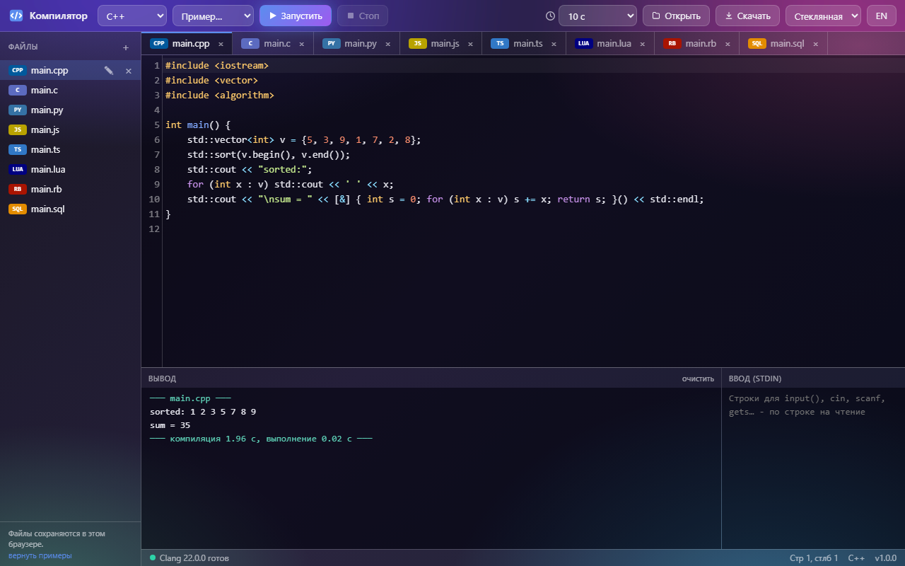
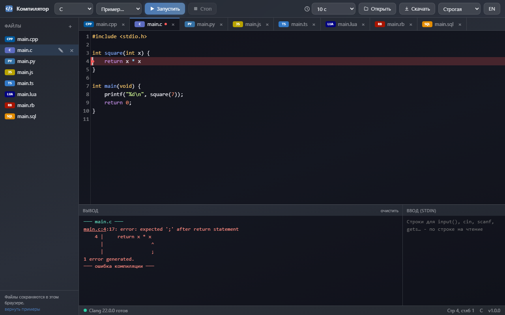
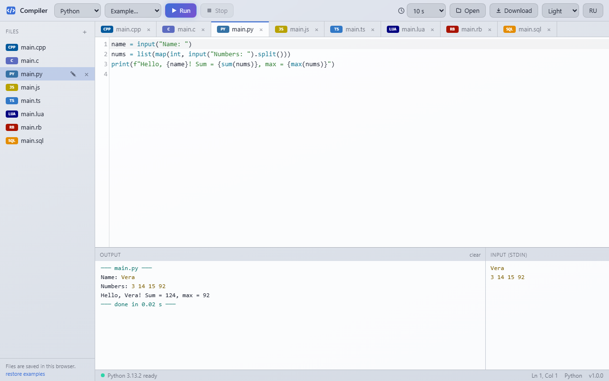
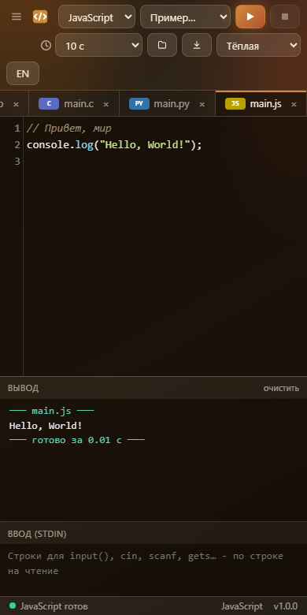

# Компилятор

[English](README.md) · **Русский**

**«Компилятор»** (Compiler) запускает программы на восьми языках прямо в браузере: **C, C++, Python, JavaScript, TypeScript, Lua, Ruby и SQL**. Сервера нет: компиляторы и интерпретаторы - WebAssembly и JavaScript внутри страницы, работает без интернета - с сайта или прямо с диска (`index.html`).

**[▶ Открыть онлайн](https://alexalesha.github.io/Compiler/)**

Интерфейс на русском и английском (кнопка RU/EN в шапке).





## Языки

| Язык | Движок | Как запускается | Загрузка при первом выборе |
|---|---|---|---|
| C | Clang 22 + LLD ([YoWASP](https://yowasp.org/)), wasi-libc | компиляция в WebAssembly (C17, `-O2`), запуск небольшим хостом WASI | ~50 МБ, общие с C++ |
| C++ | тот же Clang, libc++ | C++20, `-O2`; `<iostream>` заранее скомпилирован, небольшая программа собирается за 1-5 с вместо 10-15 | (те же) |
| Python | [Pyodide](https://pyodide.org/) 0.29.5 (Python 3.13) | интерпретатор в отдельном потоке; другие файлы `.py` проекта импортируются | ~16 МБ |
| JavaScript | движок самого браузера | программа - сценарий потока; `console.log`, `input()`, таймеры | ничего |
| TypeScript | [TypeScript](https://www.typescriptlang.org/) 5.9.3 | проверка типов (strict), потом JavaScript; ошибка типов останавливает запуск, как у компилятора | ~2 МБ |
| Lua | [Fengari](https://fengari.io/) 0.1.4 (Lua 5.3) | интерпретатор в потоке; `print`, `io.read`, `io.write` | 0,1 МБ |
| Ruby | [ruby.wasm](https://github.com/ruby/ruby.wasm) 2.10.1 (Ruby 3.4 со стандартной библиотекой) | новая машина Ruby на каждый запуск (запасная прогревается заранее) | ~12 МБ |
| SQL | [sql.js](https://sql.js.org/) 1.14.2 (SQLite) | новая пустая база на каждый запуск; операторы по одному, таблицы результатов в выводе | 0,4 МБ |

Движок грузится при первом выборе языка (вкладка с файлом этого языка), а не при открытии страницы.

## Что умеет

- **Редактор** (CodeMirror 5): подсветка всех языков, подсказки (ключевые слова и имена из файла; Ctrl+Space или просто при наборе), скобки, комментарий строки (Ctrl+/).
- **Файлы и вкладки**: список файлов (новый, переименовать, удалить с отменой) и вкладки; язык задаёт расширение. Всё сохраняется в браузере (`localStorage`, ключи `compiler.*`); если хранилище запрещено, страница работает дальше. **Открыть** читает файлы с диска, **Скачать** сохраняет текущий файл.
- **Запуск**: «Запустить» (Ctrl+Enter или F5) и «Стоп» (Shift+F5). Каждая программа - в своём Web Worker, поэтому бесконечный цикл не вешает страницу: его обрывает **предел времени** (2, 5, 10, 30, 60 с или без предела) или «Стоп».
- **Ввод**: поле «Ввод (stdin)» рядом с выводом. `input()`, `cin`, `scanf`, `gets`, `io.read`, `readline()` читают его строки; прочитанное повторяется в выводе.
- **Ошибки**: сообщения компилятора и ошибки выполнения указывают на строку: она подсвечена, на полях знак, курсор переходит к первой ошибке, `файл:строка` в выводе - ссылка.
- **Примеры** для каждого языка: «Привет, мир», циклы, рекурсия, сортировка, ввод данных.
- **Оформление**: пять тем (Стеклянная, Строгая, Светлая, Ночная, Тёплая - как в Paint Pro), вид для телефона.





### Ограничения

- Ввод готовится до запуска (поле «Ввод»); ждать нажатия клавиши программа не может.
- C/C++: нет файлов, потоков и сокетов (WASI без файловой системы); исключения C++ выключены (`-fno-exceptions`: в сборке libc++ для WebAssembly их нет), `throw`/`try` дают ошибку компиляции с подсказкой. `#include <bits/stdc++.h>` работает. Стек 8 МБ.
- Python: только стандартная библиотека (без `pip`).
- Вывод больше 2 МБ останавливает программу.

## Запуск у себя

- **Двойной щелчок по `index.html`** (Chrome, Edge, Firefox). С диска работает всё: движки - обычные файлы `<script>` (gzip + base64), ничего не скачивается.
- Или любой статический сервер из папки, например `npx http-server .` или `python -m http.server`, и открыть `http://localhost:8080/`.

Движки пересобираются из пакетов npm командой `node vendor/make-packs.js` (версии закреплены в скрипте; он же собирает готовый `<iostream>`). Python и ядро редактора лежат в `python_ide/` (общие с Python IDE сборника GameRoom; где их искать, говорит `paths.js`).

## Проверки

```
npm install
npx playwright install chromium
npm test                  # 18 законов в безголовом Chromium, по одному
node tests/mutate.js      # проверка мутациями: 11 сломанных копий должны уронить законы
```

Законы открывают `index.html` по файловому адресу при закрытой сети: Hello на JS и вывод; бесконечный цикл обрывается пределом времени, страница отвечает; «Стоп»; ошибки JS/TS/Python/C/C++/Lua/SQL/Ruby подсвечены на своей строке; `input()` в Python; Hello на C, ошибка компиляции со строкой и номером, `scanf`, код выхода, бесконечный цикл скомпилированной программы с пределом времени; C++ с `cin` и стандартной библиотекой; примеры; файлы переживают перезагрузку; скачать и открыть; темы (редактор следует теме); RU/EN; подсказки; ширина телефона. Проверка мутациями по одному ломает главные правила (предел времени, «Стоп», номера строк JS и TS, подсветку строки, переход к ошибке, разбор сообщений компилятора и Python, ввод, сохранение, темы) в копии во временной папке и саму страницу не трогает. Захват мыши в проверках - заглушка. Картинки выше сняты без окна скриптом `tools/screenshots.js`.

## История

«Компилятор» сделан в сборнике [GameRoom](https://github.com/ALEXalesha/GameRoom) (папка `web/compiler`), где он - программа раздела «Программы» в «Игротеке» ([открыть там](https://alexalesha.github.io/GameRoom/)). Этот репозиторий несёт его вместе с историей коммитов.

## Лицензии

Страница - MIT ([LICENSE](LICENSE)). Сторонние части, у каждой рядом текст лицензии:

| Часть | Где | Лицензия |
|---|---|---|
| YoWASP Clang 22 (Clang, LLD), wasi-libc, libc++ | `vendor/clang/` | Apache-2.0 WITH LLVM-exception; wasi-libc - Apache-2.0 / MIT; упаковка YoWASP - ISC |
| ruby.wasm 2.10.1 (CRuby 3.4) | `vendor/ruby/` | MIT; Ruby и библиотеки - см. NOTICE |
| TypeScript 5.9.3 | `vendor/typescript/` | Apache-2.0 |
| sql.js 1.14.2 (SQLite) | `vendor/sqljs/` | MIT; SQLite - общественное достояние |
| Fengari 0.1.4 | `vendor/fengari/` | MIT |
| CodeMirror 5.65.21 | `python_ide/vendor/codemirror/`, `vendor/codemirror/` | MIT |
| Pyodide 0.29.5 (Python 3.13.2) | `python_ide/vendor/pyodide/` | MPL-2.0; стандартная библиотека Python - PSF |
